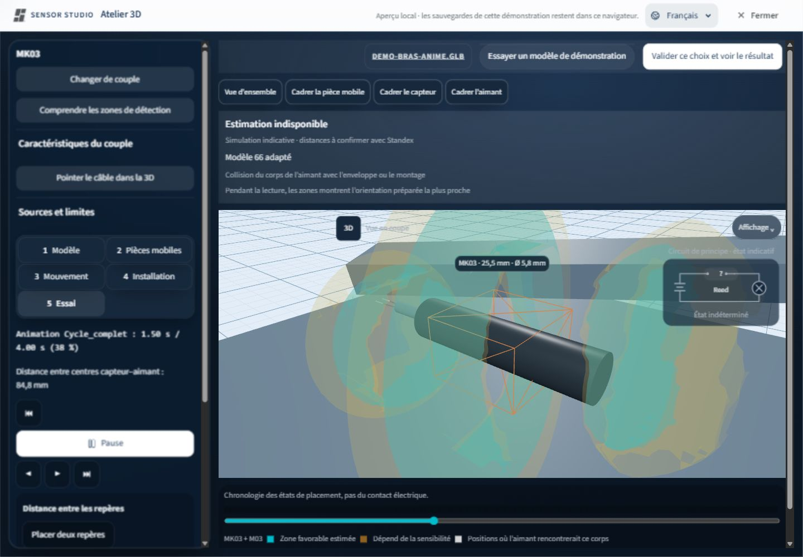
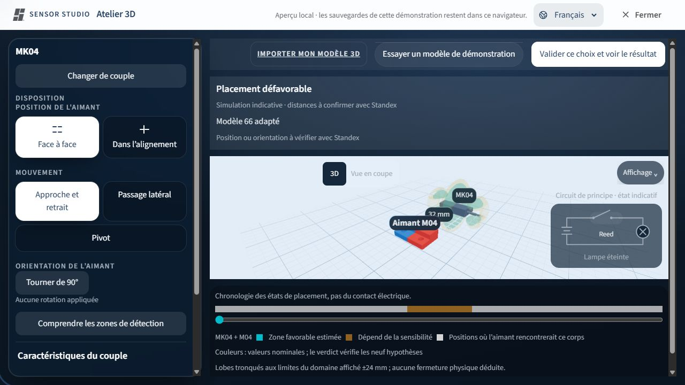
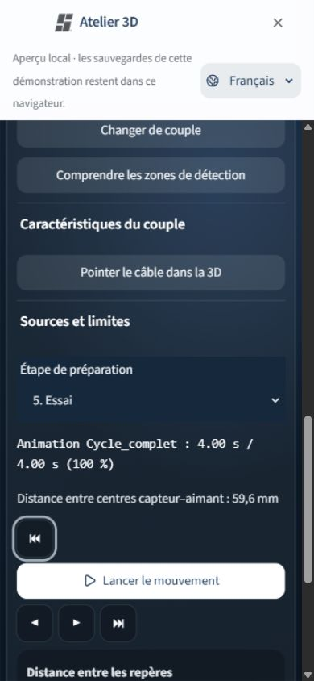

# Atelier client — continuité des zones et recette du 28 octobre 2026

Base : `5cfaf0d747c25bd38c2f9cfe086f52b9ca325349`. Branche de travail : `codex/atelier-continuous-zones`.

Ce lot termine les corrections de l'atelier client pédagogique déjà présentes dans cette base. Il ne remplace pas le parcours accueil → questionnaire → couples → atelier. La recette locale monte le vrai `MagneticWorkshop` en mode `clientPedagogical`, dans le vrai `WorkspacePanel`, avec les styles de production. Aucun changement au site publié, aucune migration ou donnée client, aucune consommation Lovable supplémentaire.

## Résultat par demande

| Demande | Comportement contrôlé |
| --- | --- |
| Disposition et orientation accessibles | Avant import : disposition, trois mouvements, quart de tour. MK04–M04 vérifié ; aucun curseur de position avancé ajouté. |
| Circuit rétabli | Circuit de principe visible et masquable. Même état pédagogique que le bandeau ; variable/indisponible reste inconnu. Ce n'est pas une prédiction électrique. |
| Menu Affichage | Noms, dimensions, circuit et zones indépendants. Vérifié aussi à 390 px. |
| Zones pendant le mouvement | Approche, passage latéral et pivot utilisent une préparation commune ; le guide importé utilise désormais ce même bouton, au lieu d'une lecture immédiate qui contournait la préparation. |
| Simplicité avant import | Les dégagements des exemples latéral/pivot sont réglés seulement après un choix explicite de mouvement/orientation. Aucun placement modifié à l'ouverture, à la restauration ou dans un montage importé. |
| Surfaces lissées | Géométries de seuil construites dans le worker, réutilisées en lecture. Coupe par contours, trous nuls conservés. Le moteur de verdict ne lit jamais le maillage dessiné. |

## Défauts corrigés pendant cette recette

- La note de préparation était dans le flux du canevas : elle pouvait provoquer une hauteur démesurée. Elle reste dans le bandeau ; les explications techniques vont dans « Sources et limites ».
- Les changements d'orientation perdaient leur volume pendant un rendu React. Les volumes préparés sont maintenant disponibles immédiatement et ne sont plus évincés à la moitié du cycle.
- Un clip GLB tournant n'était pas préparé si le mouvement de découverte était resté « approche ». Le plan reçoit les poses numériques de l'adaptateur du fichier chargé, sans transmettre ses pistes au worker.
- Le bouton du guide importé contournait cette préparation. Il réutilise maintenant la commande commune, avec progression, annulation et arrêt de la préparation lors d'un déplacement du curseur.
- Les enveloppes mobiles provoquaient un nouveau maillage par image. Le rendu applique maintenant le test des boîtes complètes aux fragments avec les enveloppes de l'instant courant.
- La coupe catalogue disparaissait en lecture. Elle utilise une section spatiale du volume préparé et reprend son calcul direct en pause.

## Recette visuelle

Vérifications locales : ordinateur et mobile 390 × 844, couple MK04–M04 avant import, quart de tour, choix de mouvement, circuit et menu Affichage ; guide en cinq étapes et fichier de démonstration `demo-bras-anime.glb`.

Pour le fichier importé : aimant attaché à la face du **Levier**, capteur à une face du **Plateau**, clip `Cycle_complet` de quatre secondes. La capture suivante montre la lecture à 1,50 s / 4,00 s (38 %), les zones conservées et le circuit indéterminé cohérent avec l'avertissement mécanique du montage. Ce montage de recette n'est pas présenté comme favorable ou validé.

À 390 px : largeur du document = largeur visible = 390 px ; canevas mesuré 359 × 481,6 px. Scène et réglages défilent dans une seule colonne, sans défilement horizontal. Les options Circuit et Zones ont été désactivées puis réactivées indépendamment. Pas d'erreur WebGL observée ; avertissement Three.Clock préexistant seulement.

## Validation technique

- Suite complète : **2 087 tests réussis, 0 échec**, 165 803 assertions, 136 fichiers (294,88 s).
- Vérification TypeScript : réussie.
- Compilation de production : réussie ; aucune commande de déploiement.
- Inventaire i18n : zéro chaîne manquante/non routée ; trois nouveaux messages dans les huit langues.
- Scans de charte : aucune nouvelle violation ; les occurrences restantes concernent la méta couleur et les matériaux Three existants, ainsi que les primitives shadcn déjà exemptées.
- Les huit fichiers figés du modèle et des données sont identiques octet par octet à la base ; 360 poses de référence reproduites sans différence.
- Nouveaux contrôles : 4 000 poses pour le masque mécanique, cycles MK04–M04 dégagés à 0°/90°, seconde moitié du plan au-delà de 48 volumes, poses d'un vrai GLB tournant, trous de coupe et comparaison directe de l'échantillonnage accéléré pour trois aimants et deux inclinaisons.

L'accélération du calcul réutilise les seules symétries exactes du modèle nominal centré, sans obstacles. Une grille décalée ou contenant les obstacles conserve son évaluation directe. La comparaison d'équivalence reste numérique, avec les mêmes seuils ; aucune simplification des paramètres physiques n'a été introduite.

## Limites conservées

- En lecture, on affiche une seule orientation déjà calculée, la plus proche, sans mélange entre volumes. Le verdict reste calculé à la pose exacte. Une transition non résolue par les sondes porte un message invitant à mettre en pause ; elle n'est jamais présentée comme certifiée.
- Le contrôle de variation de 0,5 mm sur trois rayons est local ; il ne certifie pas tout le volume. La coupe interpolée spatialement pendant la lecture est elle aussi un affichage, jamais une entrée du verdict.
- Le premier pivot peut demander environ une minute sur cette machine de recette, davantage selon le montage. Le calcul est annulable, sa progression est visible et les lectures suivantes du même réglage réutilisent les volumes. Une optimisation supplémentaire reste possible.
- Les volumes restent nominaux et limités au domaine ±24 mm. Les enveloppes importées sont des boîtes conservatrices ; elles ne décrivent pas la matière réelle avec une précision de fabrication.
- La première impression physique demeure indicative ; ces changements ne qualifient ni un couple ni un montage réel.

## Reproduire localement

Installer les dépendances du verrou existant, puis lancer `bunx vite --config vite.workshop.config.ts --host 127.0.0.1 --port 5174`.

Ouvrir `/workshop-preview.html?fresh=1` pour MK04–M04 sans montage importé ; sans ce paramètre, le harnais reprend sa sauvegarde locale éventuelle. Ce harnais n'appelle pas le backend. La fermeture ramène au site publié.

Commandes de contrôle : `bun test tests/`, `bunx --package @typescript/native-preview tsgo --noEmit`, `bun run build`, `bun scripts/i18n-inventory.ts --json`.
